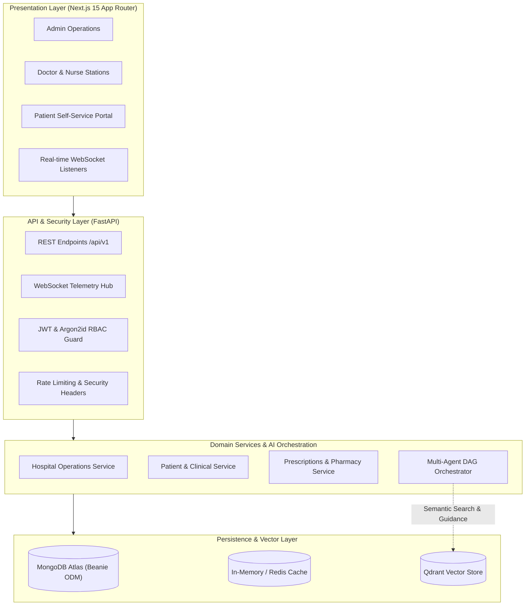

# 🏥 MediSphere AI: Enterprise Hospital Operations Intelligence & Multi-Agent Care Platform

[](#)
[](#)
[](#)
[](#)
[](#)
[](#)
[](#)

> **Enterprise-grade, Multi-Agent AI Healthcare Platform for proactive hospital operations, automated resource allocation, intelligent clinical workflows, and patient lifecycle management.**

---

## 📌 Table of Contents

- [🎯 Executive Summary](#-executive-summary)
- [✨ Key Capabilities](#-key-capabilities)
- [🏛️ System Architecture](#️-system-architecture)
- [🤖 Multi-Agent AI Orchestrator](#-multi-agent-ai-orchestrator)
- [📱 Platform Modules & Portals](#-platform-modules--portals)
- [🔑 Demo Login Accounts](#-demo-login-accounts)
- [🚀 Quick Start & Deployment](#-quick-start--deployment)
  - [Option A: One-Click Windows Launcher](#option-a-one-click-windows-launcher)
  - [Option B: Manual Local Setup (Python + Node.js)](#option-b-manual-local-setup-python--nodejs)
  - [Option C: Docker Compose Orchestration](#option-c-docker-compose-orchestration)
- [📡 API & WebSocket Telemetry](#-api--websocket-telemetry)
- [🔒 Security & HIPAA-Ready Guardrails](#-security--hipaa-ready-guardrails)
- [🧪 Testing & Quality Assurance](#-testing--quality-assurance)
- [🤝 Contributing & Git Workflow](#-contributing--git-workflow)

---

## 🎯 Executive Summary

**MediSphere AI** transitions modern hospital management from fragmented, reactive operations into proactive, data-driven intelligence. 

By combining asynchronous micro-APIs, real-time WebSocket telemetry, and LangGraph/LangChain multi-agent decision workflows, MediSphere AI optimizes emergency triage, automates bed allocations, prevents patient discharge bottlenecks, and delivers role-tailored portals for Hospital Administrators, Clinicians, Nurses, and Patients.

---

## ✨ Key Capabilities

- **Autonomous Agent Swarm:** Specialized AI agents continuously analyze triage queues, calculate bed occupancy pressures, and generate operational recommendations with DAG pipeline execution.
- **Dynamic Patient Portal:** Secure self-service portal for patients to view appointment history, active medications, vital summaries, and download signed medical prescriptions.
- **Smart Appointment Scheduling:** Real-time doctor availability checks across Cardiology, Neurology, Orthopedics, Pediatrics, and General Medicine with duplicate booking guardrails.
- **Prescription Lifecycle Management:** Comprehensive pharmacy workflow from digital Rx generation, dosage validations, allergy cross-checks, to QR-enabled printable scripts.
- **Emergency Triage & Vitals Monitoring:** Real-time vital sign tracking with automated ESI triage scoring and immediate clinician alerts.
- **Role-Based Access Control (RBAC):** Strict permissions enforcing clear boundary segregation between `admin`, `doctor`, `nurse`, and `patient`.
- **Hybrid Storage & In-Memory Resiliency:** Asynchronous MongoDB with Beanie ODM paired with seamless in-memory fallback cache and Qdrant semantic vector storage.

---

## 🏛️ System Architecture

MediSphere AI implements **Clean Architecture** and **Domain-Driven Design (DDD)** principles:



### Technology Stack

| Layer | Technologies |
| :--- | :--- |
| **Frontend UI** | Next.js 15, React 19, TypeScript, Tailwind CSS, Lucide Icons, Recharts |
| **Backend Core** | Python 3.11 - 3.14, FastAPI, Uvicorn, Pydantic v2 |
| **Database** | MongoDB Atlas, Motor (async), Beanie ODM |
| **Caching & In-Memory** | High-performance in-memory TTL caching with optional Redis 7 bridge |
| **AI & Multi-Agent** | LangChain, LangGraph StateGraph with resilient async DAG fallback, Qdrant |
| **Security** | Stateless JWT (HS256), Argon2 password hashing, OWASP security headers |
| **DevOps & Containers**| Docker, Docker Compose, Nginx, Prometheus |

---

## 🤖 Multi-Agent AI Orchestrator

The backend integrates an autonomous agent supervisor located in [`backend/app/agents/orchestrator.py`](file:///c:/Users/ksair/Downloads/MEDISPHERE/backend/app/agents/orchestrator.py):

1. **Bed Allocation Agent:** Analyzes inpatient unit capacities, forecast discharges, and flags pending overflow alerts.
2. **Emergency Triage Agent:** Computes acuity metrics, detects surge arrivals, and reallocates nursing attention dynamically.
3. **Discharge Planning Agent:** Scans pending clinical labs and insurance authorizations to expedite discharge timelines.
4. **Operations Optimizer Agent:** Synthesizes multi-department metrics into prioritized administrative action items.

---

## 📱 Platform Modules & Portals

| Module | Route | Key Features |
| :--- | :--- | :--- |
| **Executive Operations** | `/dashboard` | Hospital-wide KPIs, agent telemetry, bed occupancies, emergency count. |
| **Patient Portal** | `/dashboard/patient-portal` | Patient vitals summary, appointments, active prescriptions, print/download Rx. |
| **Appointment Booking** | `/dashboard/appointments/book` | Real-time doctor slot lookup, multi-specialty selection, auto-confirmation. |
| **Prescriptions & Rx** | `/dashboard/prescriptions` | Complete Rx lifecycle, expiration alerts, digital refill authorizations. |
| **Patient Registry** | `/dashboard/patients` | Complete EHR/EMR listing, admissions, quick vitals, allergies tracking. |
| **Emergency Triage** | `/dashboard/emergency` | Real-time ESI queue, code alerts, live ambulance tracking. |
| **Bed Intelligence** | `/dashboard/beds` | ICU, General, Emergency, and Step-down ward visual allocation grid. |
| **Department Queues** | `/dashboard/department-queue` | Cross-department wait times and ticket dispatch system. |
| **Staff Scheduling** | `/dashboard/staff/schedule` | Shift management, physician duty rotas, on-call coverage. |
| **Audit Logs** | `/dashboard/audit-logs` | HIPAA-compliant immutable audit trail of clinical and system events. |

---

## 🔑 Demo Login Accounts

Pre-configured test accounts are ready for testing each role:

| Role | Username | Password | Access Scope |
| :--- | :--- | :--- | :--- |
| **Hospital Administrator** | `admin` | `admin123` | Full access to operations, staff, audit logs, and settings |
| **Attending Physician** | `doctor` | `doctor123` | Appointments, clinical encounters, prescriptions, vitals |
| **Registered Nurse** | `nurse` | `nurse123` | Emergency triage, bed transfers, vitals recording |
| **Patient User** | `patient` | `patient123` | Personal EHR, appointment booking, prescription downloads |

---

## 🚀 Quick Start & Deployment

### Option A: One-Click Windows Launcher

If running on Windows, launch both the backend and frontend simultaneously with the provided script:

```bat
start_servers.bat
```

---

### Option B: Manual Local Setup (Python + Node.js)

#### 1. Clone the Repository
```bash
git clone https://github.com/saikumarreddy2902/MediSphereAI.git
cd MediSphereAI
```

#### 2. Backend Setup
```bash
cd backend

# Create & activate virtual environment
python -m venv .venv
.\.venv\Scripts\activate      # Windows
# source .venv/bin/activate   # Linux/macOS

# Install dependencies
pip install -r requirements.txt

# Configure environment variables
copy .env.example .env        # Windows
# cp .env.example .env        # Linux/macOS

# Start the FastAPI server
uvicorn app.main:app --host 0.0.0.0 --port 8000 --reload
```
*API Swagger Documentation will be live at `http://localhost:8000/docs`.*

#### 3. Frontend Setup
In a new terminal window:
```bash
cd frontend

# Install Node dependencies
npm install

# Configure environment variables
copy .env.example .env.local  # Windows
# cp .env.example .env.local  # Linux/macOS

# Start Next.js development server
npm run dev
```
*Web Application will be live at `http://localhost:3000`.*

---

### Option C: Docker Compose Orchestration

To run the complete production-grade containerized stack:

```bash
docker compose up -d --build
```

---

## 📡 API & WebSocket Telemetry

The platform provides comprehensive RESTful endpoints and real-time WebSocket channels:

- **Swagger Documentation:** `http://localhost:8000/docs`
- **ReDoc Interactive UI:** `http://localhost:8000/redoc`
- **Health Check:** `GET /health` or `GET /api/v1/health`
- **Telemetry WebSocket:** `ws://localhost:8000/api/v1/ws/dashboard` (Live updates for emergency arrivals, bed transfers, and system recommendations)

---

## 🔒 Security & HIPAA-Ready Guardrails

1. **Authentication:** Stateless Bearer JWT with custom TTL and role payload verification.
2. **Password Security:** OWASP-recommended Argon2id hashing algorithms with unique salts.
3. **Data Boundary Enforcement:** Pydantic v2 models validate every request body and query parameter.
4. **Audit Logging:** Every sensitive record modification writes an immutable audit record with timestamps, user ID, IP address, and change diffs.
5. **Secret Hygiene:** Database credentials and keys are strictly managed via environment variables with `.env` files excluded from version control.

---

## 🧪 Testing & Quality Assurance

Run backend and frontend test suites with coverage reports:

```bash
# Run backend pytest suite
cd backend
pytest

# Run frontend tests
cd frontend
npm test
```

---

## 🤝 Contributing & Git Workflow

1. Fork the Project
2. Create your Feature Branch (`git checkout -b feature/AmazingFeature`)
3. Commit your Changes (`git commit -m 'feat: Add some AmazingFeature'`)
4. Push to the Branch (`git push origin feature/AmazingFeature`)
5. Open a Pull Request

---

## 📄 License

Distributed under the MIT License. See `LICENSE` for more information.

*Developed with ❤️ for modern healthcare operations and patient care excellence.*
